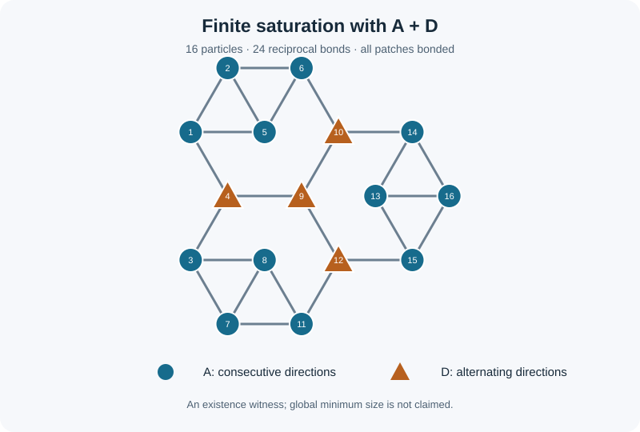

# Finite-cluster assembly on a triangular lattice

**Project owner and maintainer: Sharahil Jarjis.**

An exact computational companion to a working study of three-patch lattice gases. The question is simple: **which allowed particle orientations can form a finite, connected cluster with every patch bonded?**

There are 20 ways to select three of the triangular lattice's six nearest-neighbour directions. Rotation groups them into four orbits, called A, B, C and D. Their 15 nonempty unions form the model families studied here.

The analytical classification is: **a finite fully bonded cluster exists exactly when the family contains A and at least one other orbit.** Seven families admit such a cluster; eight do not. The included checker validates explicit positive witnesses with integer coordinates. The negative result follows from the [analytical proof](docs/classification-proof.md), not from an unsuccessful finite search.



## Reproduce the checks

Python 3.10 or later is sufficient. No third-party packages, solver, data download or simulation is required. From this project directory:

```sh
python3 scripts/verify.py
python3 scripts/draw_witness.py
```

The first command writes `results/verification.json` and reports **7 verified witnesses / 15 classified families**. It checks the complete partition of 20 patterns, allowed orientations, unique integer sites, reciprocal nearest-neighbour bonds, connectivity and full saturation. The second regenerates the SVG above.

The checked examples contain 12 particles and 18 bonds for AB and AC, and 16 particles and 24 bonds for AD. Supersets inherit these existence witnesses. These sizes are **not claimed to be globally minimal**.

## Model and method

Particles occupy sites of a single triangular lattice, with at most one particle per site. Each carries exactly three directional patches. A bond exists only when adjacent particles point reciprocal patches toward each other. Neighbouring sites can have an unbonded contact, so the bonded graph need not be an induced lattice graph.

| Orbit | Representative directions | Distinct rotations |
| --- | --- | ---: |
| A | {0, 1, 2} | 6 |
| B | {0, 1, 3} | 6 |
| C | {0, 1, 4} | 6 |
| D | {0, 2, 4} | 2 |

Direction indices run counterclockwise around the lattice and are defined in the proof. B and C are distinct under rotation and exchanged by reflection.

The exclusion argument has two parts. A supporting line forces any finite fully bonded component to contain an A particle. If only A is allowed, reciprocity propagates a top-row pattern indefinitely, contradicting finiteness. Explicit AB, AC and AD witnesses establish the remaining cases.

## Repository guide

| File | Purpose |
| --- | --- |
| [Proof and coordinate tables](docs/classification-proof.md) | Model definitions, all-size exclusion argument and explicit base witnesses |
| [Family table](data/families.json) | All 15 family records |
| [Witness coordinates](data/witnesses.json) | Seven positive witnesses, including supersets |
| [Exact checker](scripts/verify.py) | Standard-library validation with clear failure messages |
| [Saved verification](results/verification.json) | Reproduced counts and input hashes |
| [Provenance](PROVENANCE.md) | Source revision, assistance and packaging history |

## Research status

This package isolates a model-specific mathematical result from a broader lattice-gas manuscript. It does not reproduce that manuscript's historical Monte Carlo or tensor-network campaigns, establish a percolation threshold, or demonstrate experimental material assembly. No new numerical campaign was run for this release.

The proof has received internal checks and has not been independently refereed. Historical priority remains unresolved. The exact witness checks support the stated combinatorial examples; they do not by themselves establish originality. Source and tool-use details are in [provenance](PROVENANCE.md).
