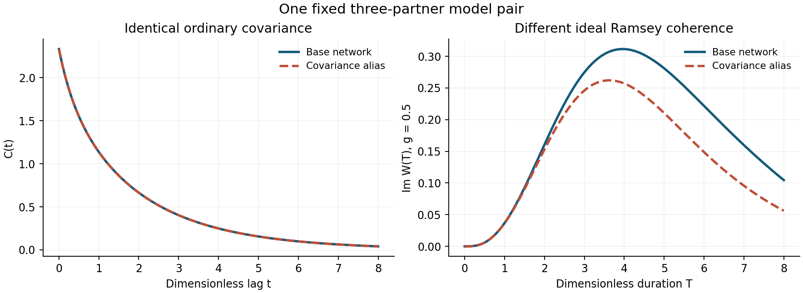

# Quantum binding-memory model study

**A reproducible study of what scalar covariance can miss about hidden binding dynamics, and what higher-order observations can recover.**

This project uses a small, reversible Markov model of binding and encounter states. Two different partner-return networks can have exactly the same ordinary covariance, yet different controlled qubit coherence. The package combines an exact example, mathematical identifiability notes, and a synthetic forward model with nuisance-parameter stress tests.

**Status:** computational and mathematical exploration, updated October 24, 2026. No molecular or device measurements are included. AI-generated proof extensions and simulations are identified in [provenance](docs/provenance.md).

## Start here

| Question | Material | What it establishes |
|---|---|---|
| Can covariance hide a different return network? | [Exact Ramsey witness](docs/exact-ramsey-witness.md) | A specific positive-rate, three-partner pair has identical covariance at every lag but a different labeled return probability. |
| Can ideal Ramsey evolution distinguish that pair? | [Exact rational checks](results/exact_witness_checks.json) | Its leading coherence difference is `−(19/1890) i g³ T⁶ + O(T⁷)` at fixed nonzero coupling. |
| How much exact moment information suffices in this model? | [Moment-order proof](docs/moment-order-proof.md) | A proposed sharp worst-case degree `2n−2`, with an explicit hidden-mode lower construction; internal checks cover `n=2,…,6`. |
| Does an exact difference imply easy inference? | [Methods and numerical results](docs/methods.md) | Synthetic nuisance fits can make two network shapes close. Expected-data KL values are not measured power or a global identification guarantee. |

## Reproduce the checks

Use Python 3.10 or later. The exact witness needs only the standard library. For the numerical checks, install the listed dependencies in a virtual environment:

```sh
python3 -m venv .venv
source .venv/bin/activate
python -m pip install -r requirements.txt
mkdir -p rerun
python scripts/verify_exact_witness.py --output rerun/exact_witness_checks.json
python scripts/check_moment_order.py --output rerun/moment_order_checks.json
python scripts/check_forward_model.py --output rerun/forward_model_checks.json
```

The checked-in `results/` files record the current verification run and the historical expected-data profiles. The commands above write fresh checks to `rerun/`. To rerun the eight-start nuisance optimization itself, use a fresh output directory:

```sh
OPENBLAS_NUM_THREADS=1 OMP_NUM_THREADS=1 python scripts/profile_likelihood.py --output-dir rerun/profiles
```

To rebuild the comparison figure, run `python scripts/make_figure.py --output rerun/model_comparison.png`.

Optimization is the slower optional step. Different numerical-library versions may give small floating-point or optimizer differences. Multiple starts do not certify a global optimum.



## Interpretation and next work

The example separates covariance from higher-order information; a nonlinear **classical** two-time moment also separates the pair. It therefore supports no quantum-advantage claim. Natural partner-specific transduction, calibration, pulse imperfections, finite data, and general network recovery remain separate questions.

The next useful task is to fix a finite control library and calibration model, then determine which return quantities remain identifiable with unknown rates and sensor parameters. The [status note](docs/status.md) distinguishes verified checks, exploratory arguments, and open work. [Literature context](docs/literature.md) records established precedents and the unresolved priority question.
